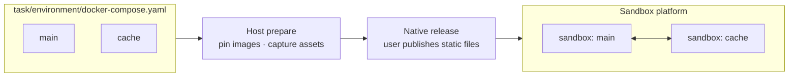

# Flotilla

[](https://github.com/matrix72c/flotilla/actions/workflows/ci.yml)
[](LICENSE)


[中文](README_zh.md)

**Prepare portable multi-service tasks once; execute isolated attempts on a sandbox platform.**

Flotilla owns a native task protocol shared by evaluation and RL consumers. Its optional Harbor importer normalizes Compose on a preparation host, pins images and captures static assets. Users publish that immutable release to platform storage. Attempts then open one sandbox per service, connect them under an explicit network policy, and clean up their private state—without parsing Compose, building images or exporting image seeds again.



## Example

A task is a directory with a `task.toml` and an `environment/` directory containing a Dockerfile, a Compose file, or both:

```text
task/
  instruction.md
  tests/test.sh            # required Harbor verifier script
  task.toml               # Harbor task configuration
  environment/
    docker-compose.yaml
```

```yaml
services:
  main:
    image: alpine:3.20
    depends_on:
      cache:
        condition: service_healthy
  cache:
    image: redis:7-alpine
    healthcheck:
      test: ["CMD", "redis-cli", "ping"]
      interval: 2s
      retries: 15
```

Prepare on a CPU host, then publish the output with your existing storage tools:

```sh
flotilla probe --deployment deployment.toml --env sandbox.env
flotilla select --host-root ./tasks --deployment deployment.toml \
  --out selected.jsonl --report selection-report.json
flotilla prepare selected.jsonl --deployment deployment.toml \
  --out ./release --name example --report prepare-report.json --image-repo registry.example.org/team/tasks
```

`prepare` may build and publish required USER0 adaptations. It does not upload the static release. Bind the local release and its published platform location in `[task_releases.example]` before executing. See [Native tasks](docs/Native_Tasks.md) for path binding, installation, credentials and migration.

```python
import asyncio

from flotilla import Flotilla, OpenOptions
from flotilla.config import FlotillaConfig
from flotilla.native import NativeAttempt


async def main():
    config = FlotillaConfig.load("deployment.toml")
    bindings = config.release_bindings()
    row = bindings.read_dataset("release/dataset.jsonl")[0]
    async with Flotilla(deployment=config) as fleet:
        attempt = await NativeAttempt.create(fleet, bindings.resolve(row))
        try:
            env = await attempt.open("main", OpenOptions(startup_timeout=600, lifetime=300))
            pong = await env.service("cache").exec(["redis-cli", "ping"], timeout=30)
            print(pong.stdout.decode().strip())
        finally:
            await attempt.close()
    assert fleet.cleanup_report is not None and fleet.cleanup_report.clean


asyncio.run(main())
```

`NativeAttempt` consumes the bound task definition and assets, creates attempt-private writable state and opens its roles. Hidden tests are staged only for verification. No source-task or builder fallback is permitted. Dataset rows name their release and task and keep order and duplicates. Metadata and capacity inspection use the prepared definitions rather than recompiling source tasks.

Harbor and Voyager share this lifecycle. Harbor remains optional, using a pinned patched build for its source/runtime interfaces. The old source-workspace APIs are legacy interfaces, not the native consumption path.

## Features

- **Compose semantics, checked up front.** `depends_on` with health conditions, healthchecks, multiple and internal networks, aliases, named volumes, bind mounts, `env_file`, `.env` interpolation, resource limits, and `user`. Every key is classified as supported, equivalent, or rejected, and a rejected key fails the task with its field path before anything is created. `flotilla inspect` shows the result locally. See [Compose support](docs/Compose_Support.md).
- **Explicit isolation.** Network policies are compiled from the Compose networks and the deployment's egress policy: none, an allowlist, or any. A task can turn off internet access entirely. Security properties the platform cannot demonstrate must be accepted by name in the deployment configuration.
- **Confirmed cleanup.** Every sandbox and directory is labeled with its owner. A lost create response is reconciled, capacity is released only after deletion is confirmed, and `flotilla gc` collects what a crashed process left behind.
- **No silent replays.** A command is never sent twice. `timed_out=True` means the remote process was confirmed stopped; if that cannot be confirmed, you get `ExecOutcomeUnknown` and the environment is retired.
- **Built for many concurrent environments.** One client manages admission, create and exec rate limits, sandbox renewal, and per-service resource defaults for every environment it opens.
- **Pluggable backends.** OpenSandbox is built in. Other platforms plug in through a Python entry point; see [Writing a backend](docs/Writing_a_Backend.md).

## Get started

Flotilla runs on **Linux x86_64 with Python 3.12**. Host import needs the optional `harbor` extra, pinned Docker Compose and preparation tools. Native execution and its Anchor do not need Harbor, Compose, Docker or a GPU stack. Build the Anchor from the installed package with `flotilla anchor build`, using a pinned Python base; publication requires explicit `--push`. Platform capabilities and cleanup must pass `flotilla probe` before consumption. See [Native tasks](docs/Native_Tasks.md) for the complete workflow and migration boundaries.

```sh
git clone https://github.com/matrix72c/flotilla.git
cd flotilla
python -m pip install .            # or: python -m pip install '.[harbor]'
```

The distribution, import name and CLI are `flotilla`. Install from this repository or a wheel built from a fixed commit; **do not run bare `pip install flotilla`**, which selects an unrelated public PyPI project. Use a fresh environment when migrating from `flotilla-compose`; the two distributions must not share an environment because they own the same Python module.

Then pick a path:

| You have | Start with |
|---|---|
| One Linux machine with Docker, and want to try it | [Local quick start](docs/Local_Quick_Start.md): run OpenSandbox and Flotilla on one machine |
| A `deployment.toml` from whoever runs your sandbox platform | [Quick start](docs/Quick_Start.md): write a task and run it from Python |
| Harbor tasks such as Terminal-Bench | [Harbor quick start](docs/Harbor_Quick_Start.md) |
| A sandbox platform to set up for your team | [Deployment guide](docs/Deployment.md) |

## Documentation

**Using Flotilla**

- [Quick start](docs/Quick_Start.md): write a multi-service task and run it.
- [Runtime API](docs/Runtime_API.md): execution, files, background processes, timeouts, cancellation, and errors.
- [Compose support](docs/Compose_Support.md): which Compose keys are supported, approximated, or rejected.
- [Harbor quick start](docs/Harbor_Quick_Start.md): run Harbor evaluations on Flotilla.

**Operating a deployment**

- [Deployment guide](docs/Deployment.md): one-time setup of images, the share release, and the capability probe.
- [Configuration reference](docs/Configuration.md): the single `deployment.toml` and generated capability evidence.
- [Platform requirements](docs/Platform_Requirements.md) and [network validation](docs/Network_Validation.md): what a deployment must enable, feature by feature, and how to verify each.
- [OpenSandbox backend](docs/backends/opensandbox.md), including [read-only root filesystems and tmpfs](docs/Readonly_Rootfs_and_Tmpfs.md).

**Extending Flotilla**

- [Integration guide](docs/Integration_Guide.md): use Flotilla from an evaluation runner or RL framework.
- [Writing a backend](docs/Writing_a_Backend.md): support another sandbox platform.
- [Architecture](docs/Architecture.md): internals and terminology.

## Status

Flotilla is alpha software. The supported targets are Linux x86_64, Python 3.12, the OpenSandbox `current` and `legacy` execd protocols, and a compatible patched Harbor build for the optional native source/runtime adapter (stock Harbor 0.24.0 lacks those interfaces). APIs and configuration may change between minor versions before 1.0; see the [changelog](CHANGELOG.md).

## Contributing

Contributions are welcome; see [CONTRIBUTING.md](CONTRIBUTING.md). Report vulnerabilities privately as described in [SECURITY.md](SECURITY.md). This project follows a [code of conduct](CODE_OF_CONDUCT.md).

## License

Flotilla is licensed under the [Apache License 2.0](LICENSE). The anchor image includes BusyBox, which is licensed under GPLv2; see [third-party components](THIRD_PARTY.md).
