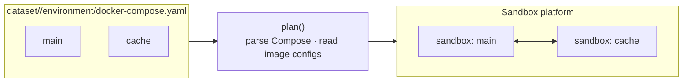

# Flotilla

[](https://github.com/matrix72c/flotilla/actions/workflows/ci.yml)
[](LICENSE)


**Run a multi-service Compose task as isolated attempts on a sandbox platform.**

Flotilla reads a published task directory, resolves it into one sandbox per service, connects them
under an explicit network policy, and cleans up its private state afterwards. Resolving a task is a
local computation: it reads the task's own files plus each image's config from the registry, and
writes nothing it later reads back. There is no build step and no intermediate artifact to publish.



## Example

A task is a directory with a `task.toml` and an `environment/` directory. A multi-service task has a Compose file there; a single-service task can
instead name its image in `task.toml` as `[environment].docker_image`. Images are published and named
by digest, and nothing is built:

```text
task/
  instruction.md
  tests/test.sh            # required Harbor verifier script
  task.toml               # Harbor task configuration
  environment/
    docker-compose.yaml
```

```yaml
services:
  main:
    image: alpine@sha256:d9e853e87e55526f6b2917df91a2115c36dd7c696a35be12163d44e6e2a4b6bc   # alpine:3.20
    depends_on:
      cache:
        condition: service_healthy
  cache:
    image: redis@sha256:7f7d30b7fdd09467bac58198a1f166dd69789d348d4fe859cccb20e0cf287fbe    # redis:7-alpine
    healthcheck:
      test: ["CMD", "redis-cli", "ping"]
      interval: 2s
      retries: 15
```

Publish that directory tree to shared storage with your existing tools, and declare where it is on
both sides. Nothing is generated in between, so the directory the platform mounts is the one you
published.

A deployment is a `FlotillaConfig` your code constructs. Whoever runs your sandbox platform gives you
its values; put them in a module of your own, next to the rest of your configuration:

```python
# myproject/deployment.py
from flotilla.config import DatasetBinding, FlotillaConfig, OpenSandbox, OpenSandboxNetwork, Storage

PLATFORM = FlotillaConfig(
    opensandbox=OpenSandbox(
        endpoint="https://sandbox.example.com",
        credential_env="SANDBOX_CREDENTIAL",
        network=OpenSandboxNetwork(sandbox_cidrs=["10.42.0.0/16"]),
    ),
    storage=Storage(host_path="/shared"),
    datasets={"example": DatasetBinding(local_root="/srv/tasks", platform_root="/shared/datasets/example")},
    reaper={"anchor_image": "registry.example.com/team/anchor@sha256:..."},
)
```

Measure the deployment's isolation once, before running anything on it. Commands outside your process
name the spec by where to import it from:

```sh
flotilla probe --deployment myproject.deployment:PLATFORM --env sandbox.env
```

See [Running published tasks](docs/Native_Tasks.md) for path binding and [Deployment](docs/Deployment.md) for credentials and the anchor.

```python
import asyncio

from flotilla import Flotilla, OpenOptions
from flotilla.native import NativeAttempt

from myproject.deployment import PLATFORM


async def main():
    dataset = PLATFORM.resolve_datasets()["example"]
    async with Flotilla(deployment=PLATFORM) as fleet:
        attempt = await NativeAttempt.create(fleet, dataset.source("demo/redis"))
        try:
            env = await attempt.open("main", OpenOptions(startup_timeout=600, lifetime=300))
            pong = await env.service("cache").exec(["redis-cli", "ping"], timeout=30)
            print(pong.stdout.decode().strip())
        finally:
            await attempt.close()
    assert fleet.cleanup_report is not None and fleet.cleanup_report.clean


asyncio.run(main())
```

`NativeAttempt` resolves the task directory into one plan per role, creates attempt-private writable
state and opens those roles. The task's own files are mounted read-only, straight from where they are
published; only a writable volume is materialized per attempt. Hidden tests are staged only for
verification.

Harbor drives the same lifecycle itself, in place of this loop:

```sh
harbor run --env flotilla.integrations.harbor:FlotillaTaskEnvironment \
  --ek deployment=myproject.deployment:PLATFORM \
  --path /srv/tasks/example/ds/demo
```

See [running harbor trials](docs/Integration_Guide.md#running-harbor-trials) for what the environment
does per trial.

## Features

- **Compose semantics, checked up front.** `depends_on` with health conditions, healthchecks, multiple and internal networks, aliases, named volumes, bind mounts, `env_file`, `.env` interpolation, resource limits, and `user`. Every key is classified as equivalent, warned, or rejected, and a rejected key fails the task with its field path before anything is created. The Compose subset is parsed by Flotilla itself, with no `docker compose` binary; `flotilla inspect` shows the result locally. See [Compose support](docs/Compose_Support.md).
- **Explicit isolation.** Network policies are compiled from the Compose networks and the deployment's egress policy: none, an allowlist, or any. A task can turn off internet access entirely. An isolation property `flotilla probe` cannot demonstrate must be accepted by name in the spec.
- **Confirmed cleanup.** Every sandbox and directory is labeled with its owner. A lost create response is reconciled, capacity is released only after deletion is confirmed, and `flotilla gc` collects what a crashed process left behind.
- **No silent replays.** A command is never sent twice. `timed_out=True` means the remote process was confirmed stopped; if that cannot be confirmed, you get `ExecOutcomeUnknown` and the environment is retired.
- **Built for many concurrent environments.** One client manages admission, create and exec rate limits, sandbox renewal, and per-service resource defaults for every environment it opens.
- **Pluggable backends.** OpenSandbox is built in. Another backend lives in the source tree and is added to the `BACKENDS` table in `flotilla/config.py`; see [Writing a backend](docs/Writing_a_Backend.md).

## Get started

Flotilla runs on **Linux x86_64 with Python 3.12**. A task's `task.toml` is Harbor's format, so
`harbor` is a required dependency; nothing needs Docker, a Compose binary or a GPU stack. A
deployment's isolation must pass `flotilla probe` before use; see the
[deployment guide](docs/Deployment.md).

```sh
git clone https://github.com/matrix72c/flotilla.git
cd flotilla
python -m pip install .
```

The distribution, import name and CLI are `flotilla`. Install from this repository or a wheel built from a fixed commit; **do not run bare `pip install flotilla`**, which selects an unrelated public PyPI project. Use a fresh environment when migrating from `flotilla-compose`; the two distributions must not share an environment because they own the same Python module.

Then pick a path:

| You have | Start with |
|---|---|
| One Linux machine with Docker, and want to try it | [Local quick start](docs/Local_Quick_Start.md): run OpenSandbox and Flotilla on one machine |
| Deployment values from whoever runs your sandbox platform | [Quick start](docs/Quick_Start.md): write a task and run it from Python |
| Harbor tasks such as Terminal-Bench | [Running published tasks](docs/Native_Tasks.md): run a published Harbor-format dataset with `NativeAttempt`, or drive it with `harbor run` itself |
| A sandbox platform to set up for your team | [Deployment guide](docs/Deployment.md) |

## Documentation

**Using Flotilla**

- [Quick start](docs/Quick_Start.md): write a multi-service task and run it.
- [Running published tasks](docs/Native_Tasks.md): task layout, datasets, the two grading phases, and `flotilla inspect`.
- [Runtime API](docs/Runtime_API.md): execution, files, background processes, timeouts, cancellation, and errors.
- [Compose support](docs/Compose_Support.md): which Compose keys are supported, approximated, or rejected.

**Operating a deployment**

- [Deployment guide](docs/Deployment.md): one-time setup of the anchor and share release, dataset binding, the isolation probe, and feature enablement.
- [Configuration reference](docs/Configuration.md): every field of a deployment spec.
- [OpenSandbox backend](docs/backends/opensandbox.md): execd protocols, storage/network mapping, and read-only rootfs, tmpfs and shared memory.

**Extending Flotilla**

- [SDK surface](docs/SDK.md): what may be imported from `flotilla`, `flotilla.native`, `flotilla.integrations.harbor`, and `flotilla.testing`, and the stability commitments.
- [Integration guide](docs/Integration_Guide.md): use Flotilla from an evaluation runner or RL framework, or run harbor trials directly.
- [Writing a backend](docs/Writing_a_Backend.md): support another sandbox platform.
- [Architecture](docs/Architecture.md): internals and terminology.

## Status

Flotilla is alpha software. The supported targets are Linux x86_64, Python 3.12, the OpenSandbox `current` and `legacy` execd protocols, and released Harbor (`harbor>=0.26.0,<0.27`) for harbor-driven trials. APIs and configuration may change between minor versions before 1.0; see the [changelog](CHANGELOG.md).

## Contributing

Contributions are welcome; see [CONTRIBUTING.md](CONTRIBUTING.md). Report vulnerabilities privately as described in [SECURITY.md](SECURITY.md). This project follows a [code of conduct](CODE_OF_CONDUCT.md).

## License

Flotilla is licensed under the [Apache License 2.0](LICENSE). The anchor image includes BusyBox, which is licensed under GPLv2; see [third-party components](THIRD_PARTY.md).
