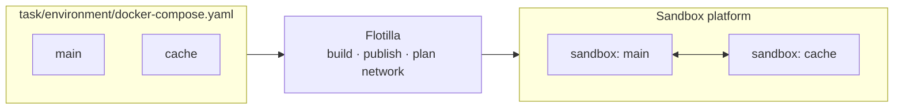

# Flotilla

[](https://github.com/matrix72c/flotilla/actions/workflows/ci.yml)
[](LICENSE)


[中文](README_zh.md)

**Run Docker Compose task environments on a sandbox platform, one sandbox per service, thousands at a time.**

Agent evaluation and RL tasks are often Compose projects: an agent container plus a database, a web app, or a vulnerable service. Docker Compose runs them on one host. Sandbox platforms scale out, but they run single containers. Flotilla takes the Compose project, gives each service its own sandbox, connects them under an explicit network policy, and deletes everything when you're done.



## Example

A task is a directory with a `task.toml` and an `environment/` directory containing a Dockerfile, a Compose file, or both:

```text
task/
  task.toml               # [environment] table, may be empty
  environment/
    docker-compose.yaml
```

```yaml
services:
  main:
    image: alpine:3.20
    depends_on:
      cache:
        condition: service_healthy
  cache:
    image: redis:7-alpine
    healthcheck:
      test: ["CMD", "redis-cli", "ping"]
      interval: 2s
      retries: 15
```

```python
import asyncio

from flotilla import Flotilla, OpenOptions


async def main():
    async with Flotilla(deployment="deployment.toml") as fleet:
        async with fleet.environment("task", OpenOptions(startup_timeout=600, lifetime=300)) as env:
            pong = await env.service("cache").exec(["redis-cli", "ping"], timeout=30)
            print("cache:", pong.stdout.decode().strip())
            result = await env.agent.shell("printf 'PING\\r\\n' | nc -w 2 cache 6379", timeout=30)
            print("main -> cache:", result.stdout.decode().strip())
            assert result.exit_code == 0 and not result.timed_out
    assert fleet.cleanup_report is not None and fleet.cleanup_report.clean


asyncio.run(main())
```

Flotilla resolves or builds the images, waits for `cache` to pass its healthcheck before starting `main`, makes `cache` resolvable by name from `main`, and confirms on exit that both sandboxes and their shared directories have been deleted. Harbor tasks run the same way through the [Harbor adapter](docs/Harbor_Quick_Start.md).

## Features

- **Compose semantics, checked up front.** `depends_on` with health conditions, healthchecks, multiple and internal networks, aliases, named volumes, bind mounts, `env_file`, `.env` interpolation, resource limits, and `user`. Every key is classified as supported, equivalent, or rejected, and a rejected key fails the task with its field path before anything is created. `flotilla inspect` shows the result locally. See [Compose support](docs/Compose_Support.md).
- **Explicit isolation.** Network policies are compiled from the Compose networks and the deployment's egress policy: none, an allowlist, or any. A task can turn off internet access entirely. Security properties the platform cannot demonstrate must be accepted by name in the deployment configuration.
- **Confirmed cleanup.** Every sandbox and directory is labeled with its owner. A lost create response is reconciled, capacity is released only after deletion is confirmed, and `flotilla gc` collects what a crashed process left behind.
- **No silent replays.** A command is never sent twice. `timed_out=True` means the remote process was confirmed stopped; if that cannot be confirmed, you get `ExecOutcomeUnknown` and the environment is retired.
- **Built for many concurrent environments.** One client manages admission, create and exec rate limits, sandbox renewal, and per-service resource defaults for every environment it opens.
- **Pluggable backends.** OpenSandbox is built in. Other platforms plug in through a Python entry point; see [Writing a backend](docs/Writing_a_Backend.md).

## Get started

Flotilla runs on **Linux x86_64 with Python 3.12**, and needs Docker with BuildKit on the machine that prepares images.

```sh
git clone https://github.com/matrix72c/flotilla.git
cd flotilla
python -m pip install .            # or: python -m pip install '.[harbor]'
```

The distribution is named `flotilla-compose`; the import name and CLI are `flotilla`.

Then pick a path:

| You have | Start with |
|---|---|
| One Linux machine with Docker, and want to try it | [Local quick start](docs/Local_Quick_Start.md): run OpenSandbox and Flotilla on one machine |
| A `deployment.toml` from whoever runs your sandbox platform | [Quick start](docs/Quick_Start.md): write a task and run it from Python |
| Harbor tasks such as Terminal-Bench | [Harbor quick start](docs/Harbor_Quick_Start.md) |
| A sandbox platform to set up for your team | [Deployment guide](docs/Deployment.md) |

## Documentation

**Using Flotilla**

- [Quick start](docs/Quick_Start.md): write a multi-service task and run it.
- [Runtime API](docs/Runtime_API.md): execution, files, background processes, timeouts, cancellation, and errors.
- [Compose support](docs/Compose_Support.md): which Compose keys are supported, approximated, or rejected.
- [Harbor quick start](docs/Harbor_Quick_Start.md): run Harbor evaluations on Flotilla.

**Operating a deployment**

- [Deployment guide](docs/Deployment.md): one-time setup of images, the share release, and the capability probe.
- [Configuration reference](docs/Configuration.md): every `deployment.toml` and `declared.json` field.
- [Platform requirements](docs/Platform_Requirements.md) and [network validation](docs/Network_Validation.md): what a deployment must provide and how to verify it.
- [OpenSandbox backend](docs/backends/opensandbox.md), including [read-only root filesystems and tmpfs](docs/Readonly_Rootfs_and_Tmpfs.md).

**Extending Flotilla**

- [Integration guide](docs/Integration_Guide.md): use Flotilla from an evaluation runner or RL framework.
- [Writing a backend](docs/Writing_a_Backend.md): support another sandbox platform.
- [Architecture](docs/Architecture.md): internals and terminology.

## Status

Flotilla is alpha software. The supported targets are Linux x86_64, Python 3.12, the OpenSandbox `current` and `legacy` execd protocols, and Harbor 0.24.0 for the optional adapter. APIs and configuration may change between minor versions before 1.0; see the [changelog](CHANGELOG.md).

## Contributing

Contributions are welcome; see [CONTRIBUTING.md](CONTRIBUTING.md). Report vulnerabilities privately as described in [SECURITY.md](SECURITY.md). This project follows a [code of conduct](CODE_OF_CONDUCT.md).

## License

Flotilla is licensed under the [Apache License 2.0](LICENSE). The anchor image includes BusyBox, which is licensed under GPLv2; see [third-party components](THIRD_PARTY.md).
