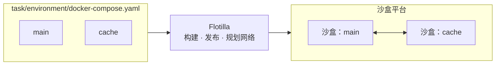

# Flotilla

[](https://github.com/matrix72c/flotilla/actions/workflows/ci.yml)
[](LICENSE)


[English](README.md)

**把 Docker Compose 任务环境跑在沙盒平台上：每个服务一个沙盒，可同时运行成千上万个环境。**

智能体评测和强化学习的任务通常是一个 Compose 项目：一个智能体容器，加上数据库、Web 应用或带漏洞的服务。Docker Compose 只能在单机上运行它们；沙盒平台可以横向扩展，却只运行单个容器。Flotilla 读取 Compose 项目，为每个服务创建一个沙盒，按显式的网络策略把它们连起来，用完后把所有资源删除干净。



## 示例

一个任务是一个目录，包含 `task.toml` 和 `environment/` 目录，后者里有 Dockerfile、Compose 文件或两者都有：

```text
task/
  task.toml               # [environment] 表，可以为空
  environment/
    docker-compose.yaml
```

```yaml
services:
  main:
    image: alpine:3.20
    depends_on:
      cache:
        condition: service_healthy
  cache:
    image: redis:7-alpine
    healthcheck:
      test: ["CMD", "redis-cli", "ping"]
      interval: 2s
      retries: 15
```

```python
import asyncio

from flotilla import Flotilla, OpenOptions


async def main():
    async with Flotilla(deployment="deployment.toml") as fleet:
        async with fleet.environment("task", OpenOptions(startup_timeout=600, lifetime=300)) as env:
            pong = await env.service("cache").exec(["redis-cli", "ping"], timeout=30)
            print("cache:", pong.stdout.decode().strip())
            result = await env.agent.shell("printf 'PING\\r\\n' | nc -w 2 cache 6379", timeout=30)
            print("main -> cache:", result.stdout.decode().strip())
            assert result.exit_code == 0 and not result.timed_out
    assert fleet.cleanup_report is not None and fleet.cleanup_report.clean


asyncio.run(main())
```

Flotilla 会解析或构建镜像，等 `cache` 通过健康检查后再启动 `main`，让 `main` 能按服务名访问 `cache`，并在退出时确认两个沙盒及其共享目录都已删除。Harbor 任务也通过 [Harbor 适配器](docs/Harbor_Quick_Start.md)以同样方式运行。

## 特性

- **Compose 语义，提前校验。** 支持带健康条件的 `depends_on`、健康检查、多网络和内部网络、别名、命名卷、绑定挂载、`env_file`、`.env` 变量替换、资源限制和 `user`。每个键都会被归类为支持、等价近似或拒绝；只要有一个键被拒绝，任务就会在创建任何资源之前失败，并给出字段路径。`flotilla inspect` 可以在本地查看结果。详见 [Compose 支持](docs/Compose_Support.md)。
- **显式隔离。** 网络策略由 Compose 网络和部署的出站策略（禁止、白名单或全部放行）编译而来，任务也可以完全关闭外网。平台无法证明的安全属性，必须在部署配置中按名称显式接受。
- **确认式清理。** 每个沙盒和目录都带有归属标签。创建请求的响应丢失时会自动对账；只有确认删除后才释放配额；进程崩溃遗留的资源可以用 `flotilla gc` 回收。
- **绝不静默重放。** 命令永远不会被发送两次。`timed_out=True` 表示远端进程已确认停止；无法确认时会抛出 `ExecOutcomeUnknown`，该环境随即作废。
- **面向大规模并发。** 一个客户端统一管理它打开的所有环境的准入、创建与执行限速、沙盒续期，以及按服务的资源默认值。
- **可插拔后端。** 内置 OpenSandbox 后端；其他平台可以通过 Python entry point 接入，见[编写后端](docs/Writing_a_Backend.md)。

## 开始使用

Flotilla 运行在 **Linux x86_64 + Python 3.12** 上，准备镜像的机器上需要有支持 BuildKit 的 Docker。

```sh
git clone https://github.com/matrix72c/flotilla.git
cd flotilla
python -m pip install .            # 或：python -m pip install '.[harbor]'
```

发行包名为 `flotilla-compose`，导入名和命令行工具名为 `flotilla`。

然后按你的情况选一条路径（文档为英文）：

| 你手上有 | 从这里开始 |
|---|---|
| 一台装了 Docker 的 Linux 机器，想先试试 | [本机快速上手](docs/Local_Quick_Start.md)：在一台机器上运行 OpenSandbox 和 Flotilla |
| 沙盒平台运维方提供的 `deployment.toml` | [快速上手](docs/Quick_Start.md)：编写任务并从 Python 运行 |
| Terminal-Bench 等 Harbor 任务 | [Harbor 快速上手](docs/Harbor_Quick_Start.md) |
| 需要为团队搭建一个沙盒平台 | [部署指南](docs/Deployment.md) |

## 文档

**使用 Flotilla**

- [快速上手](docs/Quick_Start.md)：编写一个多服务任务并运行。
- [运行时 API](docs/Runtime_API.md)：命令执行、文件、后台进程、超时、取消和错误。
- [Compose 支持](docs/Compose_Support.md)：哪些 Compose 键被支持、近似处理或拒绝。
- [Harbor 快速上手](docs/Harbor_Quick_Start.md)：在 Flotilla 上运行 Harbor 评测。

**运维部署**

- [部署指南](docs/Deployment.md)：一次性准备镜像、share release 和能力探测。
- [配置参考](docs/Configuration.md)：`deployment.toml` 和 `declared.json` 的全部字段。
- [平台要求](docs/Platform_Requirements.md)与[网络验证](docs/Network_Validation.md)：部署必须逐项启用哪些功能，以及如何逐项验证。
- [OpenSandbox 后端](docs/backends/opensandbox.md)，包括[只读根文件系统与 tmpfs](docs/Readonly_Rootfs_and_Tmpfs.md)。

**扩展 Flotilla**

- [集成指南](docs/Integration_Guide.md)：在评测框架或强化学习框架中使用 Flotilla。
- [编写后端](docs/Writing_a_Backend.md)：支持新的沙盒平台。
- [架构](docs/Architecture.md)：内部实现与术语。

## 项目状态

Flotilla 目前是 alpha 版本。支持的目标环境为 Linux x86_64、Python 3.12、OpenSandbox 的 `current` 和 `legacy` 两种 execd 协议，可选的 Harbor 适配器对应 Harbor 0.24.0。1.0 之前，次版本之间的 API 和配置可能发生变化，详见[变更日志](CHANGELOG.md)。

## 参与贡献

欢迎贡献，请阅读 [CONTRIBUTING.md](CONTRIBUTING.md)。安全漏洞请按 [SECURITY.md](SECURITY.md) 私下报告。本项目遵循[行为准则](CODE_OF_CONDUCT.md)。

## 许可证

Flotilla 采用 [Apache License 2.0](LICENSE) 许可。anchor 镜像包含以 GPLv2 许可的 BusyBox，详见[第三方组件](THIRD_PARTY.md)。
