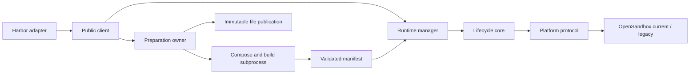

# Architecture

## Terminology

| Term | Meaning |
|---|---|
| Task | A directory with `task.toml` and an `environment/` directory containing a Dockerfile or Compose file |
| Environment | One running instance of a task: a group of sandboxes, one per service |
| Service | One Compose service; the main service is `env.agent`, others are sidecars |
| Trial | Flotilla's internal unit for one environment's sandboxes, labels, and lifecycle |
| Launch | One running Flotilla client process; every resource it creates carries its launch ID |
| Anchor | A small, renewable sandbox per launch that mounts the shared-storage root and performs file operations on it |
| Share release | An immutable directory of helper binaries (BusyBox) mounted into every sandbox at `/.flotilla` |
| Task publication | An immutable, content-addressed copy of a task's files on shared storage |
| Capability report | `capabilities.json`, written by `flotilla probe`: what the deployment supports, each item `probed` or `declared` |
| Declaration | `declared.json`: operator assertions for properties the probe cannot measure |
| Security gap / waiver | A security capability the deployment lacks; startup refuses unless it is listed in `security.accept_insecure` |
| execd | The OpenSandbox daemon inside each sandbox that runs commands and transfers files |
| GC | Explicit collection of resources left by crashed launches (`flotilla gc`) |

## Components

`compose` validates source semantics into a project. `build` resolves images and exports files without platform access. Preparation owns the subprocess, temporary directory, Docker-container journal, and publication staging. The IPC manifest is validated at the subprocess boundary; the runtime prepares one private parsed result and digest from it. Project, manifest, and runtime plan serve distinct boundaries.

`runtime` owns admission, environment handles, monitoring, and cleanup. Each client has one maintenance loop in a separate thread. Diagnostic callbacks use a bounded dispatcher thread; local file scans and reads use owned thread work that must settle before their directory is removed. Preparation capacity is retained if cleanup cannot be confirmed.

`core` depends on the Platform protocol and injected Clock. Its anchor is a renewable sandbox mounting the shared root. Launch and trial labels allow reconciliation after uncertain creates; a create response timeout does not imply that creation failed. Startup reserves replacement capacity and uses actual dependency gates. Cleanup releases capacity only after deletion is confirmed.

A ready environment has a finite lifetime. Operations verify ownership and service health. Cancellation tracks remote execution attempts, interrupts identified commands, and confirms their status. If stopping cannot be proved, the environment becomes unusable and deletion takes over. Background-result delivery has the same responsibility. Commands are never replayed automatically.

Shared storage separates immutable share releases, immutable task publications, and launch-owned writable directories. Task file digests and `FILES.json` use the same canonical entries, including original numeric ownership and modes. Publication validates content, stages it, restores metadata, and renames atomically without overwriting an existing release. `mv -n` can return success without moving; the anchor checks source disappearance.

The anchor stops admitting new work after its renewal grace period. GC uses two observations and list-visibility bounds to avoid collecting a live owner. Explicit GC handles abandoned resources after crashes; it is not a scheduler inside the runtime.

Reading entry points: `runtime/client.py`, `preparation/service.py`, `core/trial.py`, `core/reaper.py`, and `platform/base.py`. The public `flotilla.testing` package provides clocks, fake registries, and a deliberately limited fake platform for downstream contract tests; it ships in the wheel, and runtime packages never import it. See [the API](Runtime_API.md) for user contracts, [OpenSandbox](backends/opensandbox.md) for protocol details, and [downstream contracts](downstream.md) for the testing surface.
