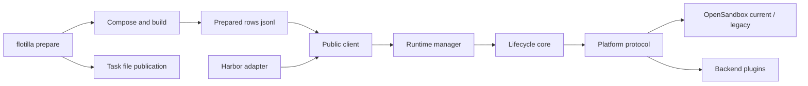

# Architecture

## Terminology

| Term | Meaning |
|---|---|
| Task | A directory with `task.toml` and an `environment/` directory containing a Dockerfile or Compose file |
| Environment | One running instance of a task: a group of sandboxes, one per service |
| Service | One Compose service; the main service is `env.agent`, others are sidecars |
| Trial | Flotilla's internal unit for one environment's sandboxes, labels, and lifecycle |
| Launch | One running Flotilla client process; every resource it creates carries its launch ID |
| Anchor | A small, renewable sandbox per launch that mounts the shared-storage root and performs file operations on it |
| Share release | An immutable directory of helper binaries (BusyBox) mounted into every sandbox at `/.flotilla` |
| Prepared row | One line of the jsonl `flotilla prepare` writes: a task's digest-pinned environments and published files |
| Task publication | A task environment's files on shared storage, at `tasks/<dataset>/<task>/<role>` |
| Capability report | `capabilities.json`, written by `flotilla probe`: what the deployment supports, each item `probed` or `declared` |
| Declaration | `declared.json`: operator assertions for properties the probe cannot measure |
| Security gap / waiver | A security capability the deployment lacks; startup refuses unless it is listed in `security.accept_insecure` |
| execd | The OpenSandbox daemon inside each sandbox that runs commands and transfers files |
| GC | Explicit collection of resources left by crashed launches (`flotilla gc`) |

## Components

`compose` validates source semantics into a project. `build` resolves images and exports files without platform access. `prepare` runs offline: it builds every task once, publishes task files with staging and an atomic rename, journals Docker export containers, and appends one validated row per task. The runtime opens rows only; it never builds, scans, or uploads task files. Project, manifest, and runtime plan serve distinct boundaries.

`runtime` owns admission, environment handles, monitoring, and cleanup. Each client has one maintenance loop in a separate thread. Diagnostic callbacks use a bounded dispatcher thread; local file reads use owned thread work that must settle before their directory is removed.

`backends` selects the platform: the built-in OpenSandbox backend or a plugin from the `flotilla.backends` entry-point group, and every caller (runtime, probe, GC, share) constructs it through `FlotillaConfig.build_platform`. See [Writing a backend](Writing_a_Backend.md).

`core` depends on the Platform protocol and injected Clock. Its anchor is a renewable sandbox mounting the shared root. Launch and trial labels allow reconciliation after uncertain creates; a create response timeout does not imply that creation failed. Startup reserves replacement capacity and uses actual dependency gates. Cleanup releases capacity only after deletion is confirmed.

A ready environment has a finite lifetime. Operations verify ownership and service health. Cancellation tracks remote execution attempts, interrupts identified commands, and confirms their status. If stopping cannot be proved, the environment becomes unusable and deletion takes over. Background-result delivery has the same responsibility. Commands are never replayed automatically.

Shared storage separates immutable share releases, replaceable task publications, and launch-owned writable directories. Task files live under `tasks/<dataset>/<task>/<role>`; publication stages their content, restores original numeric ownership and modes, then replaces the role directory by rename. Volume seed archives include root-directory metadata, even for empty image directories. Before a forced rebuild replaces any files, prepare removes the selected tasks' old rows, so interruption leaves those tasks pending instead of pairing old manifests with new files. Share releases remain immutable, with checksums in `RELEASE.json`. `mv -n` can return success without moving; the anchor checks source disappearance.

The anchor stops admitting new work after its renewal grace period. GC uses two observations and list-visibility bounds to avoid collecting a live owner. Explicit GC handles abandoned resources after crashes; it is not a scheduler inside the runtime.

Reading entry points: `runtime/client.py`, `prepare/runner.py`, `core/trial.py`, `core/reaper.py`, and `platform/base.py`. The public `flotilla.testing` package provides clocks, fake registries, and a deliberately limited fake platform for downstream contract tests; it ships in the wheel, and runtime packages never import it. See [the API](Runtime_API.md) for user contracts, [OpenSandbox](backends/opensandbox.md) for protocol details, and [integration guide](Integration_Guide.md) for the testing surface.
