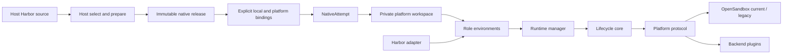

# Architecture

## Terminology

| Term | Meaning |
|---|---|
| Native task | A versioned definition with instruction, role manifests, immutable assets, verification and artifact contracts |
| Source task | A Harbor directory imported on the preparation host; not a runtime input |
| Environment | One running instance of a task: a group of sandboxes, one per service |
| Service | One Compose service; the main service is `env.agent`, others are sidecars |
| Trial | Flotilla's internal unit for one environment's sandboxes, labels, and lifecycle |
| Launch | One running Flotilla client process; every resource it creates carries its launch ID |
| Anchor | A small, renewable sandbox per launch that mounts the shared-storage root and performs file operations on it |
| Share release | An immutable directory of helper binaries (BusyBox) mounted into every sandbox at `/.flotilla` |
| Dataset row | Release ID, task reference and digest, plus annotations and parameters |
| Task release | A directory of `tasks/<key>/` definitions and static files plus a `dataset.jsonl`, bound by name to local/platform roots |
| Attempt workspace | Launch-owned private role state, verification staging and artifact handoff directories |
| Capability report | `capabilities.json`, written by `flotilla probe`: what the deployment supports, each item `passed`, `failed`, `skipped`, or `error` |
| Security gap / waiver | A security capability the deployment lacks; startup refuses unless it is listed in `security.accept_insecure` |
| execd | The OpenSandbox daemon inside each sandbox that runs commands and transfers files |
| GC | Explicit collection of resources left by crashed launches (`flotilla gc`) |

## Components

`compose` validates source semantics on the preparation host. `build` resolves images, captures original execution identity, exports volume seeds and publishes required USER0 adaptations there. `flotilla prepare` atomically produces a native release and dataset. Users publish static files using their existing tools. `NativeAttempt` consumes verified native definitions and assets without Harbor parsing, Compose, build/push/mirror or image-seed export. Native roles reuse existing manifest, plan and scheduler boundaries rather than introducing a second runtime. See [Native tasks](Native_Tasks.md) for the protocol and immutable-publication trust boundary.

`runtime` owns admission, environment handles, monitoring, and cleanup. Each client has one maintenance loop in a separate thread. Diagnostic callbacks use a bounded dispatcher thread; local file reads use owned thread work that must settle before their directory is removed.

`backends` selects the platform: the built-in OpenSandbox backend or a plugin from the `flotilla.backends` entry-point group, and every caller (runtime, probe, GC, share) constructs it through `FlotillaConfig.build_platform`. See [Writing a backend](Writing_a_Backend.md).

`core` depends on the Platform protocol and injected Clock. Its anchor is a renewable sandbox mounting the shared root. Launch and trial labels allow reconciliation after uncertain creates; a create response timeout does not imply that creation failed. Startup reserves replacement capacity and uses actual dependency gates. Cleanup releases capacity only after deletion is confirmed.

A ready environment has a finite lifetime. Operations verify ownership and service health. Cancellation tracks remote execution attempts, interrupts identified commands, and confirms their status. If stopping cannot be proved, the environment becomes unusable and deletion takes over. Background-result delivery has the same responsibility. Commands are never replayed automatically.

Shared storage separates immutable shared-tools releases, native task releases and launch-owned workspaces at `launches/<launch>/attempts/<attempt>`. Hidden tests remain private to the trusted Anchor; agent roles receive only selected mounts, public instruction and writable state. Verification stages tests after the agent stops. A separately declared verifier role receives declared handoff artifacts read-only; otherwise verification uses the main role. Role instances must be deleted before their workspace. Local and platform release files are verified, not just their manifest IDs.

The native Anchor contains installed Flotilla and filesystem helpers, not Harbor/Compose/build tooling or push credentials. Host preparation owns those optional dependencies. The old `HarborAttempt` and management workspace helper remain explicitly legacy APIs, not native fallbacks. No automatic DinD, protocol fallback or credential baking is performed. Offline tests do not establish real platform acceptance or a compatible published image.

The anchor stops admitting new work after its renewal grace period. GC uses two observations and list-visibility bounds to avoid collecting a live owner. Explicit GC handles abandoned resources after crashes; it is not a scheduler inside the runtime.

Reading entry points: `runtime/client.py`, `runtime/workspace.py`, `native/runtime.py`, `native/release.py`, `core/trial.py`, `core/reaper.py`, and `platform/base.py`. The public `flotilla.testing` package provides clocks, fake registries, and a deliberately limited fake platform for downstream contract tests; it ships in the wheel, and runtime packages never import it. See [the API](Runtime_API.md) for user contracts, [OpenSandbox](backends/opensandbox.md) for protocol details, and [integration guide](Integration_Guide.md) for the testing surface.
