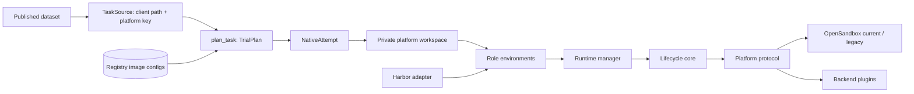

# Architecture

## Terminology

| Term | Meaning |
|---|---|
| Task | A published directory: `task.toml`, an `environment/` Compose project, `instruction.md`, and `tests/` |
| Trial plan | What a task resolves to: one unit per service, with its image, resources, mounts, network and dependencies |
| Environment | One running instance of a task: a group of sandboxes, one per service |
| Service | One Compose service; the main service is `env.agent`, others are sidecars |
| Trial | Flotilla's internal unit for one environment's sandboxes, labels, and lifecycle |
| Launch | One running Flotilla client process; every resource it creates carries its launch ID |
| Anchor | A small, renewable sandbox per launch that mounts the shared-storage root and performs file operations on it |
| Share release | An immutable directory of helper binaries (BusyBox) mounted into every sandbox at `/.flotilla` |
| Dataset | A directory of task directories, declared by name and bound to a local and a platform root |
| Task source | Where one task's files are, on the client and on the platform; both, because neither side can infer the other |
| Attempt workspace | Launch-owned private role state, verification staging and artifact handoff directories |
| Capability report | `capabilities.json`, written by `flotilla probe`: what the deployment supports, each item `passed`, `failed`, `skipped`, or `error` |
| Security gap / waiver | A security capability the deployment lacks; startup refuses unless it is listed in `security.accept_insecure` |
| execd | The OpenSandbox daemon inside each sandbox that runs commands and transfers files |
| GC | Explicit collection of resources left by crashed launches (`flotilla gc`) |

## Components

`compose` reads a task directory and resolves it into a `TrialPlan`: it loads the Compose project itself, normalizes it into Flotilla's supported subset with a finding per rejected field, and reads each image's config from the registry by digest. This is a local computation over immutable inputs, so it writes nothing and can be run over a whole dataset before any sandbox exists. `NativeAttempt` resolves a task into one plan per role plus how it is graded, and opens them. See [Native tasks](Native_Tasks.md) for the immutable-publication trust boundary.

`runtime` owns admission, environment handles, monitoring, and cleanup. Each client has one maintenance loop in a separate thread. Diagnostic callbacks use a bounded dispatcher thread; local file reads use owned thread work that must settle before their directory is removed.

`backends` selects the platform: the built-in OpenSandbox backend or a plugin from the `flotilla.backends` entry-point group, and every caller (runtime, probe, GC, share) constructs it through `FlotillaConfig.build_platform`. See [Writing a backend](Writing_a_Backend.md).

`core` depends on the Platform protocol and injected Clock. Its anchor is a renewable sandbox mounting the shared root. Launch and trial labels allow reconciliation after uncertain creates; a create response timeout does not imply that creation failed. Startup reserves replacement capacity and uses actual dependency gates. Cleanup releases capacity only after deletion is confirmed.

A ready environment has a finite lifetime. Operations verify ownership and service health. Cancellation tracks remote execution attempts, interrupts identified commands, and confirms their status. If stopping cannot be proved, the environment becomes unusable and deletion takes over. Background-result delivery has the same responsibility. Commands are never replayed automatically.

Shared storage separates the immutable shared-tools release at `share/`, published datasets on whatever roots the deployment declares, and launch-owned workspaces at `launches/<launch>/attempts/<attempt>`. A plan may name task files anywhere on declared storage but never under `launches/` or `share/`, which are Flotilla's own. Task files are mounted read-only where they are published, so nothing is copied to run them; only a writable bind group or a named volume becomes trial-owned storage. Hidden tests remain private to the trusted Anchor; agent roles receive only selected mounts, public instruction and writable state. Verification stages tests after the agent stops. A separately declared verifier role receives declared handoff artifacts read-only; otherwise verification uses the main role. Role instances must be deleted before their workspace.

The Anchor contains installed Flotilla and filesystem helpers, not a Compose executable, a builder or push credentials: Flotilla reads images, it does not write them. No automatic DinD, protocol fallback or credential baking is performed. Offline tests do not establish real platform acceptance or a compatible published image.

The anchor pauses new creates and directory operations once renewal is overdue by its grace period and resumes when a renewal succeeds; the launch and its trials are lost only when the anchor's TTL could have expired. GC uses two observations and list-visibility bounds to avoid collecting a live owner. Explicit GC handles abandoned resources after crashes; it is not a scheduler inside the runtime.

Reading entry points: `runtime/client.py`, `runtime/workspace.py`, `native/runtime.py`, `native/dataset.py`, `compose/plan_task.py`, `core/trial.py`, `core/reaper.py`, and `platform/base.py`. The public `flotilla.testing` package provides clocks, fake registries, and a deliberately limited fake platform for downstream contract tests; it ships in the wheel, and runtime packages never import it. See [the API](Runtime_API.md) for user contracts, [OpenSandbox](backends/opensandbox.md) for protocol details, and [integration guide](Integration_Guide.md) for the testing surface.
